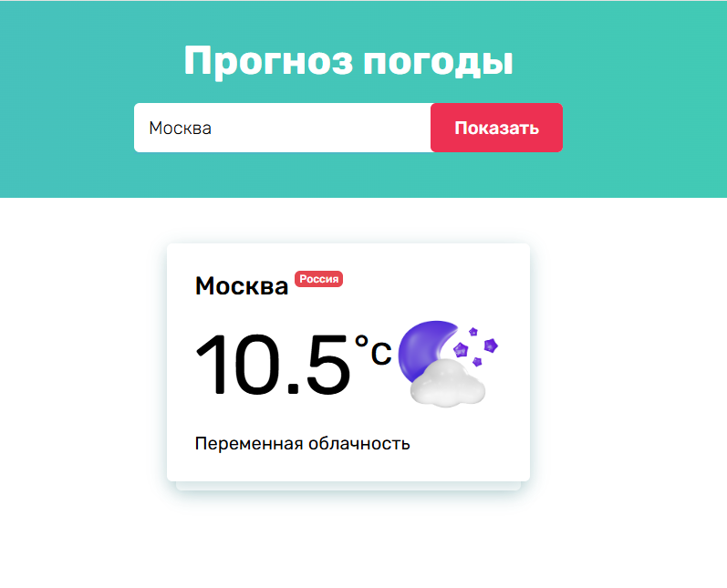

# Weather Widget

Виджет текущей погоды: поиск города с подсказками, температура, описание погоды на русском и иконка с учётом времени суток. Данные загружаются из WeatherAPI.

🔗 **Демо:** [sweetp35-weather-widget.netlify.app](https://sweetp35-weather-widget.netlify.app/)



## Стек

JavaScript (ES6+, модули), HTML5, CSS3, Fetch API, async/await

## Возможности

- Поиск города с выпадающими подсказками (до 10 вариантов, задержка ввода — debounce)
- Список городов России с рекурсивным разбором вложенных регионов
- Текущая температура и описание погоды на русском языке
- Разные иконки для дня и ночи
- Обработка ошибок: город не найден, нет соединения

## Запуск

```bash
npx vite
```

Или откройте проект через любой локальный сервер (например, Live Server в VS Code).
